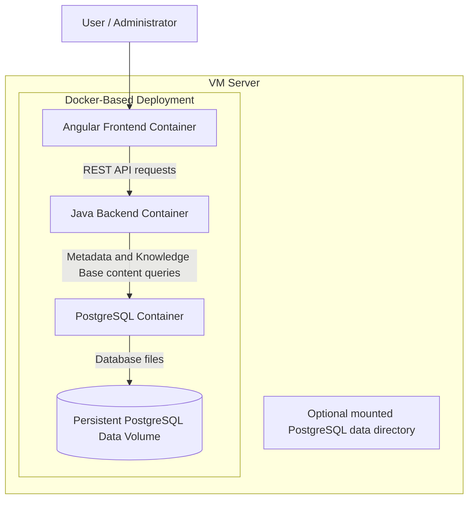

# KBMT

**KBMT** is an open-source Knowledge Bases application designed to help users organise, access, navigate, and read collections of knowledge documents through a web-based interface.

The application supports multiple Knowledge Bases, each containing Markdown, HTML, and metadata files. Knowledge Bases can contain learning material, technical documentation, reference information, and other authorised content.

KBMT uses Angular for the frontend, Spring Boot with Spring Data JPA and Spring Security for the Java backend, and PostgreSQL for application data, including all Knowledge Base content, metadata, and access control. No Knowledge Base content is persistently stored in an application-managed filesystem. User passwords are stored as BCrypt hashes. The application uses a Docker-based deployment architecture on a VM server.

KBMT is released under the **GNU General Public License v3.0 (GPL-3.0)**.

## Repository Workflow

- Do not create Git branches.
- Do not push to Git.
- Only the developer will run Git commands.

## 1. Objectives

KBMT aims to provide:

- A central application for managing multiple **Architecture Methodologies and TOGAF as Knowledge Bases**.
- A consistent structure for all Knowledge Bases.
- A web-based interface for browsing and reading documents.
- Direct creation of Knowledge Bases and upload of their content files.
- ZIP import and export for Knowledge Bases.
- PostgreSQL storage for Knowledge Base Markdown and HTML documents, metadata files, and access permissions.
- Version identification for each Knowledge Base.
- Access control for readers and administrators.
- A secure mechanism for uploading, replacing, and soft-deactivating Knowledge Bases.
- A Docker-based deployment model.
- An open-source platform that can be extended by the community.

## 2. Initial Features

### 2.1 Knowledge Base Management

KBMT will support multiple independent Knowledge Bases.

Each Knowledge Base will have its own collection of Markdown and HTML documents and metadata files.

Knowledge Bases may contain:

- Learning material.
- Technical documentation.
- Product documentation.
- Reference material.
- Standards and guidelines.
- Training material.
- Other authorised knowledge content.

Each Knowledge Base will have a title, version, description, content type, storage identifier, and associated document metadata.

Administrators will manage the Knowledge Base collection through the application.

### 2.2 Knowledge Base Content

A Knowledge Base will contain Markdown documents, HTML documents, and metadata files.

Supported content file types are:

- Markdown files (`.md`).
- HTML files.
- Metadata files. The accepted metadata format and file naming convention must be defined before implementation.

The application will store all Knowledge Base content in PostgreSQL, including content uploaded directly and imported from ZIP archives. This includes Markdown and HTML documents, metadata files, the required `README.md`, and Table of Contents content. The application will not keep a persistent filesystem copy of Knowledge Base content.

The application will display Markdown content in a readable format and serve approved HTML content through the Angular frontend.

### 2.3 Knowledge Base Navigation

Users will be able to browse the Knowledge Bases they are authorised to access.

The application will provide a Table of Contents for each Knowledge Base.

Users will be able to:

- Select a Knowledge Base.
- View the list of pages available in that Knowledge Base.
- Select a page from the list.
- Read the document.
- Navigate to other documents within the same Knowledge Base.
- View authorised HTML documents and metadata-backed navigation resources.

The reader interface will provide a Knowledge Base dropdown followed by a page list for the selected Knowledge Base. Selecting a page loads and displays its Markdown content. The backend must return only pages belonging to the selected, active Knowledge Base and enforce reader access.

The application will not require users to download an entire Knowledge Base to read an individual document.

### 2.4 Knowledge Base Content Upload, ZIP Import, and Export

Administrators will be able to create a Knowledge Base by registering its metadata, then upload Markdown, HTML, and approved metadata files through the application. Each uploaded file will be associated with the selected Knowledge Base and a logical path within it. A configurable per-file size limit will default to 100 KB for each Markdown, HTML, or metadata file. The backend will validate the file type, size, and path and store its content in PostgreSQL.

Administrators will also be able to import a Knowledge Base from a ZIP archive. The backend will validate the archive structure and entries, read the Knowledge Base name and version from its metadata, and store the validated Markdown, HTML, metadata files, and logical paths in PostgreSQL. Each allowed content file inside the archive remains subject to the configurable 100 KB default per-file limit. There are no limits on ZIP archive size, number of entries, or total uncompressed content for import or export. The Knowledge Base name (`title`) identifies an existing Knowledge Base; its version is stored as metadata. If the name already exists, the administrator must select an overwrite checkbox to replace it, and the imported version must differ from the existing version. Without the checkbox, import must reject the duplicate and report an error. If the name does not exist, import creates a new Knowledge Base. Import must report success or failure to the administrator.

Administrators will be able to export a Knowledge Base as a ZIP archive reconstructed from its PostgreSQL metadata and content. The exported archive will follow the required Knowledge Base structure, include the metadata needed to identify its name and version, preserve logical content paths, and be valid input for the ZIP import process. Export and re-import must preserve the Knowledge Base metadata and file contents.

ZIP is a transfer format, not the runtime storage format. After direct upload or ZIP import, document and resource requests will retrieve content from PostgreSQL. The backend will extract the uploaded archive, store its metadata and allowed content files in PostgreSQL only after successful validation, and delete the uploaded ZIP after a successful import. A failed import must report an error and leave existing content unchanged.

### 2.5 Knowledge Base Administration

Administrators will be able to:

- Create a Knowledge Base and register its metadata.
- Upload approved content files to a selected Knowledge Base.
- Import a Knowledge Base from a ZIP archive using an administrator-only file picker and an overwrite checkbox for an existing title.
- Export a selected Knowledge Base as a downloadable ZIP through an administrator-only action.
- Replace an existing Knowledge Base version.
- Soft-deactivate or reactivate a Knowledge Base without deleting its metadata.
- Manage access permissions.
- View the registered documents and their metadata.

The application must validate metadata and each content file before accepting it. A successful direct file upload activates its Knowledge Base. ZIP imports and replacements must not become active until the complete archive has been validated and stored successfully. Knowledge Base records must not be physically deleted through application operations; deactivation is represented by an active status.

Replacement and deactivation operations must avoid leaving Knowledge Base metadata and content inconsistent in PostgreSQL.

### 2.6 Search and Discovery

The initial application will provide basic Knowledge Base discovery.

Users should be able to locate Knowledge Bases and documents using available metadata, including:

- Knowledge Base title.
- Version.
- Description.
- Content type.
- Document name.
- Document title.
- Relevant tags, where supported.

More advanced full-text, semantic, and AI-assisted search may be considered for future releases.

## 3. Knowledge Base Content Types

Each Knowledge Base must specify one of the following content types.

### 3.1 Free

Content made available without a charge, subject to the applicable licence, copyright, and usage terms.

### 3.2 Open-source

Content distributed under an identified open-source licence or other applicable open licence.

The relevant licence must be identified where applicable.

### 3.3 Copyrighted

Content subject to copyright restrictions and the permissions granted by its copyright owner.

The administrator must ensure that the application is authorised to store and provide access to this content.

### 3.4 Content Type and Licensing

The content type describes the intended usage or distribution category of a Knowledge Base.

It does not replace the actual licence, copyright notice, or permission terms.

KBMT must not assume that content is free to copy, modify, or redistribute simply because it is available without charge.

---

## 4. Application Architecture

KBMT will use a **Docker-based deployment architecture** on a VM server. The application components will run in separate containers. PostgreSQL is the authoritative persistent store for application data, including all Knowledge Base content.

### 4.1 Architecture Components

- **Angular Frontend:** Provides the user interface for browsing, uploading, and managing Knowledge Bases.
- **Java Backend:** Exposes REST APIs, implements business logic, validates file uploads and ZIP archives, manages access control, and serves Knowledge Base content.
- **PostgreSQL Database:** Stores Knowledge Base metadata, Markdown and HTML document content, metadata files, permissions, and optional audit records.
- **Docker:** Provides containerisation for the application components and supports consistent deployment.
- **Persistent PostgreSQL Storage:** Stores the PostgreSQL database cluster independently of the database container lifecycle. It uses a named Docker volume or an appropriately configured persistent host directory. This is database-managed storage; the application does not store Knowledge Base content in a separate filesystem location.
- **VM Server:** Hosts the Docker deployment and provides the underlying disk storage for persistent database volumes or mounted directories.

### 4.2 Target Deployment Architecture

The following diagram illustrates the target architecture. Knowledge Base content and application metadata are stored together in PostgreSQL. The PostgreSQL data volume persists the database cluster across container lifecycles.



The diagram shows the logical deployment. A named Docker volume is the preferred way to persist PostgreSQL data. A mounted host directory is an alternative for the PostgreSQL data directory. No separate Knowledge Base content volume or host directory is used.

### 4.3 Knowledge Base Content and ZIP Transfer

1. An administrator creates a Knowledge Base by registering its metadata, or imports one from a ZIP archive.
2. For direct authoring, the administrator uploads approved content files to the selected Knowledge Base. For ZIP import, the backend validates the archive and its root `README.md` metadata.
3. The backend validates allowed file types, per-file sizes, ZIP structure, and logical paths. The default per-file limit is 100 KB and is configurable.
4. The backend stores validated content and associated metadata in PostgreSQL as one safe activation operation.
5. The backend serves authorised content through the REST API and can export a selected Knowledge Base as a ZIP archive reconstructed from PostgreSQL.

Directly uploaded and ZIP-imported Knowledge Base Markdown, HTML, and metadata files are stored in PostgreSQL with their Knowledge Base identifiers and logical paths. Archive paths cannot select a server filesystem location. Exported archives preserve the logical hierarchy and can be imported again.

### 4.4 Deployment Principles

- Deploy the Angular frontend, Java backend, and PostgreSQL as separate Docker containers.
- Keep all Knowledge Base content in PostgreSQL so it persists independently of the backend container lifecycle.
- Persist PostgreSQL data independently of the database container lifecycle using a named Docker volume by default, or a mounted host directory when required.
- Ensure the backend is the authorised access point for protected Knowledge Base content.
- Configure database credentials and other secrets securely; do not hard-code them into application source code.
- Ensure the deployment can be recreated consistently across development, testing, and production environments.
- Ensure that container replacement or recreation does not unintentionally delete persistent data.

### 4.5 Frontend Location, Experience, and Themes

- The Angular frontend source code must be located in the repository's `frontend/` directory, alongside `backend/`.
- The interface must use a clean, uncluttered corporate style with clear headings, readable typography, generous spacing, and familiar navigation.
- The default visual direction is a light interface with warm-white or light-gray surfaces, dark-charcoal text, and a restrained muted-blue or teal accent for links and primary actions.
- Provide three selectable visual themes: **Light**, **Gray**, and **Black**. Light is the default theme. All themes must maintain readable text contrast and accessible controls.
- Use CSS styling and theme variables so the corporate look and feel can be applied consistently and adjusted without changing application behavior.
- The frontend is a separately deployable Docker application component and communicates with the Java backend over the REST API.

### 4.6 Frontend Authentication and Permissions

- Users sign in with their user ID and password through `POST /api/users/login` or the compatible `POST /api/users/logon` endpoint. After validating credentials, the backend returns the user's ID and permissions plus a signed JWT access token.
- Protected API requests accept `Authorization: Bearer <accessToken>`. For browser use, login also sets a 15-minute HttpOnly, SameSite=Strict JWT cookie, which Swagger UI sends automatically. Access tokens use HS256 and are signed with a Base64-encoded `JWT_SECRET` containing at least 32 random bytes. The signing secret must come from runtime configuration and must never be committed or logged.
- The frontend uses the returned permissions to present available pages and actions, keeps the access token in memory, and clears the browser cookie on sign-out. There is no server-side session, refresh token, or token revocation list in this minimal implementation; permissions embedded in a token may remain effective until that token expires.
- Users with `USER_ACCESS` may access reader pages and perform read-only operations on Knowledge Bases and their content.
- Users with `ADMINISTRATOR_USER_ACCESS` may access reader pages and administrative pages and perform the administrative operations allowed by the backend.
- Users without the required permission must not be shown protected pages or actions. The backend must independently enforce every permission check, as specified in Section 10.3.
- The frontend must provide a sign-out action that clears the in-memory authentication state and clear feedback for failed authentication or denied access.
- Production deployments must use HTTPS for frontend and API traffic so credentials and protected content are encrypted in transit. Local development may use HTTP on localhost. Docker deployment must provide HTTPS at the application entry point, such as through a TLS-terminating reverse proxy; containerisation alone does not provide HTTPS.
- The frontend must not persist passwords or access tokens in browser storage. Access tokens should be held in memory only while the user is signed in.

### 4.7 Reader and Administrator User Journeys

#### Reader journey

1. The user signs in with their user ID and password.
2. The application displays the Knowledge Bases that the user's permissions allow them to access. The list should show the title, version, and description where available, and provide basic metadata search.
3. The user selects a Knowledge Base and opens its reading view.
4. The reading view presents the Table of Contents alongside the selected Markdown or HTML document. If no Table of Contents is supplied, the application presents navigation generated from registered document metadata.
5. The user selects other documents from the navigation and continues reading. The user can return to the Knowledge Base list and sign out at any time.

#### Administrator journey

1. The administrator signs in with their user ID and password and receives the reader experience plus an Admin area.
2. In the Admin area, the administrator creates a Knowledge Base and uploads content files, or selects a ZIP file to import. The administrator may select overwrite for a same-title Knowledge Base; replacement requires a different version. The application displays validation errors or import confirmation.
3. The administrator can download a selected Knowledge Base as a ZIP archive, and can select a Knowledge Base to replace, deactivate, or reactivate it. The application requests confirmation before replacement or deactivation and displays the operation result.
4. The administrator finds a user and grants or revokes reader or administrator permissions. The application confirms permission changes and reports success or failure.

The user journeys describe the intended frontend experience. Upload, document retrieval, replacement, and deactivation require corresponding backend API operations before those steps can work end to end.

### 4.8 Container Build and Release Stages

Containerisation will be delivered in two stages.

#### Stage 1: Build and publish application images

- Build and publish separate frontend and backend images. Each application image must have its own Dockerfile in its application directory: `frontend/Dockerfile` and `backend/Dockerfile`.
- Build the Angular frontend with Node.js and serve its production files from an Alpine-based runtime image.
- Build and run the Java backend on Ubuntu 24.04 LTS with Java 21.
- Label and publish the first-stage images with version `1.0`, using separate Docker Hub repositories, for example `<namespace>/KBMT-frontend:1.0` and `<namespace>/KBMT-backend:1.0`.
- The project maintainer builds and publishes the images to Docker Hub. Application secrets must not be included in either image.
- Stage 1 does not provide a Compose deployment or a PostgreSQL container. The backend requires its database connection and bootstrap administrator configuration through runtime environment variables when run.
- The frontend image must serve the Angular single-page application and forward `/api` requests to the backend service named `backend` on port `8080`, ready for the shared network defined in Stage 2.

#### Stage 2: Compose deployment

- Add `docker-compose/compose.yaml` to run the frontend, backend, and PostgreSQL as separate services. Keep the Stage 2 `.env` and `.env.example` in the same directory.
- Use the full image references `docker.io/zs6bvr/KBMT-frontend:1.0` and `docker.io/zs6bvr/KBMT-backend:1.0` in the Compose file; do not configure the Docker Hub namespace through an environment variable.
- Connect the services on a shared Docker network. The frontend must be able to reach the backend by the service name `backend`; the backend must reach PostgreSQL by its Compose service name.
- Use the official PostgreSQL image and pin it to a supported major version. Do not use the floating `latest` tag for deployments.
- Persist PostgreSQL data using a named Docker volume or a local bind mount under `docker-compose/data`; this directory must not be committed. The database contains all Knowledge Base content as well as metadata.
- Provide deployment-specific secrets and configuration at runtime. A local `.env` file may supply Compose variables but must be excluded from version control and must not be copied into application images. Commit a `.env.example` containing variable names and placeholders only. Production deployments should inject secrets through the deployment environment or a secrets manager.
- Production access must use HTTPS for frontend and API traffic, with TLS provided by the deployment's HTTPS entry point. Docker or Compose alone does not enable TLS.

Stage 2 Compose configuration, PostgreSQL image version, persistent volumes, and runtime secret delivery are not part of Stage 1 image publishing.

---

## 5. Technology Stack

KBMT will use a Docker-based containerised deployment architecture.

| Component | Technology |
|---|---|
| Frontend | Angular |
| Backend | Java |
| API | REST |
| Database | PostgreSQL |
| Knowledge Base content storage | PostgreSQL |
| PostgreSQL cluster persistence | Named Docker volume or mounted host directory |
| Import format | ZIP |
| Document format | Markdown |
| Build | Gradle |
| Testing | JUnit |
| Code coverage | JaCoCo |
| Code quality | SonarQube |
| Containerisation | Docker |
| IDE | IntelliJ IDEA Community Edition |

The initial implementation will be designed to run locally using Docker and will also support development directly from IntelliJ IDEA Community Edition. The README Quick Start must remind developers to start the PostgreSQL Docker container before running the backend, which depends on that database.

---

## 6. Knowledge Base Structure and Storage

KBMT uses Docker containerisation for application deployment. All Knowledge Base content is stored in PostgreSQL. PostgreSQL's database cluster is persisted on the VM server through a Docker volume or a mounted host directory.

A named Docker volume is the preferred option for PostgreSQL persistence when administrators do not require direct access to database files on the VM server.

### 6.1 Knowledge Base Metadata Fields

When an administrator creates a Knowledge Base directly or imports it from a ZIP file, the application records the following metadata. For ZIP import, the root `README.md` supplies the metadata fields.

| Field | Required / Optional | Description |
|---|---|---|
| `title` | Required | The title of the Knowledge Base. |
| `folder_name_version` | Required | The unique folder identifier derived from the Knowledge Base title and version. |
| `version` | Required | The version number of the Knowledge Base. |
| `isActive` | Required | Whether the Knowledge Base is active and visible in listings. `false` soft-deactivates it without deleting its record. |
| `author` | Optional | The author of the Knowledge Base. |
| `email_address` | Optional | The author's email address. |
| `Table_Of_Contents` | Optional | The Table of Contents content or resource reference, if provided. |

The application must validate all required fields before registering a Knowledge Base. The API requires `isActive` on create and update requests; listing endpoints return active Knowledge Bases only.

Optional fields may be left blank. Their absence must not prevent an otherwise valid Knowledge Base from being uploaded.

The `folder_name_version` field is a unique logical identifier for the Knowledge Base and its imported archive hierarchy. It must conform to the application's naming rules and must not be treated as an arbitrary filesystem path.

### 6.2 Knowledge Base README.md

Each Knowledge Base ZIP file must contain a `README.md` file describing the Knowledge Base.

The README must use a consistent structure so that KBMT can validate and register the Knowledge Base metadata.

The following fields must be represented in the README.

| README field | Required / Optional |
|---|---|
| Title | Required |
| Folder Name and Version (`folder_name_version`) | Required |
| Version | Required |
| Author | Optional |
| Email Address | Optional |
| Table of Contents (`Table_Of_Contents`) | Optional |

#### 6.2.1 README Field Definitions

- **Title — Required:** The display title of the Knowledge Base.
- **Folder Name and Version — Required:** The unique logical identifier for the Knowledge Base.
- **Version — Required:** The version number of the Knowledge Base.
- **Author — Optional:** The name of the person or organisation responsible for the content.
- **Email Address — Optional:** The author's contact email address.
- **Table of Contents — Optional:** A Table of Contents supplied with the Knowledge Base. If omitted, KBMT may provide navigation using registered document metadata.

The README field names and their interpretation must be consistent across all Knowledge Bases.

#### 6.2.2 Example README.md

The following example shows all six fields, including the optional fields.

```markdown
# TOGAF Architecture Guide v1.0

## Title

TOGAF Architecture Guide

## Folder Name and Version

TOGAF_Architecture_Guide_v1.0

## Version

1.0

## Author (Optional)

Architecture Documentation Team

## Email Address (Optional)

architecture@example.com

## Table_Of_Contents (Optional)

TABLE_OF_CONTENTS.md
```

The example email address is illustrative and must be replaced with a valid address if an author email is supplied.

If the author, email address, or Table of Contents is not available, its field may be omitted or left blank according to the agreed README validation rules.

### 6.3 Knowledge Base Content Structure

Each Knowledge Base has its own logical content namespace in PostgreSQL. The namespace is identified by its Knowledge Base name and version, represented by `folder_name_version`; archive entry paths remain relative to that Knowledge Base.

Example:

```text
TOGAF_Architecture_Guide_v1.0/ (logical Knowledge Base namespace)
├── README.md
├── TABLE_OF_CONTENTS.md
├── Chapter_01.md
├── Chapter_02.html
└── metadata-file (format and name to be defined)
```

This tree illustrates the logical hierarchy represented by the uploaded ZIP. It is not a directory created for application storage. The application stores each allowed entry's logical path and content in PostgreSQL.

### 6.4 ZIP Import, Direct Upload, and Export

#### ZIP import

When an administrator imports a Knowledge Base ZIP file, the backend will:

1. Receive the ZIP file through the Angular frontend.
2. Validate logical paths, allowed file types, and each content file's size. Do not limit the ZIP archive's size, entry count, or total uncompressed content.
3. Inspect and validate archive entries and their logical paths without activating them.
4. Locate and validate the `README.md` file at the archive root.
5. Read and validate the required metadata fields: `title`, `folder_name_version`, and `version`.
6. Read the optional metadata fields: `author`, `email_address`, and `Table_Of_Contents`, when supplied.
7. Validate the document hierarchy and supporting resource references represented by the archive entries.
8. Match the metadata `title` against existing Knowledge Bases. If it exists, replace it only when the administrator selected the overwrite checkbox and the imported version differs from the existing version; otherwise reject the import. If it does not exist, create a new Knowledge Base.
9. Persist the validated Knowledge Base content, metadata, and permissions in PostgreSQL as one safe activation operation.
10. Delete the uploaded ZIP after a successful import and notify the administrator of success. On failure, notify the administrator and leave existing database content unchanged.
11. Make the successfully imported or replaced Knowledge Base available according to its active status.

The backend must not activate an invalid or incomplete Knowledge Base. If import fails, database changes must be rolled back and any existing active Knowledge Base must remain usable.

#### Direct content upload

Administrators must be able to upload Markdown, HTML, and approved metadata files to a selected Knowledge Base. Each file must be validated and stored in PostgreSQL with its Knowledge Base identifier, logical path, content type, and other required resource metadata. The configurable per-file size limit defaults to 100 KB for each allowed type. The upload operation must reject invalid paths, unsupported file types, duplicate logical paths, and files that exceed the configured size limit. After each successful direct file upload, the Knowledge Base becomes active.

#### ZIP export

Administrators must be able to export a selected Knowledge Base as a streamed ZIP archive generated from its PostgreSQL metadata and content. The archive must include the required root `README.md`, preserve the logical paths and file bytes, and follow the same structure and validation rules accepted by ZIP import. There are no limits on exported archive size, entry count, or total content, and export must not create a persistent filesystem copy. Exported content must be re-importable without content loss.

### 6.5 Persistent Storage

- **Docker containerisation:** The application components run in Docker containers on the VM server.
- **Knowledge Base content:** PostgreSQL stores all imported and individually uploaded Knowledge Base content, including Markdown, HTML, metadata files, README content, Table of Contents content, permissions, and optional audit records.
- **Database persistence:** PostgreSQL's data directory must survive container restarts, upgrades, replacement, and recreation. Use a named Docker volume by default or a mounted host directory when required.
- **No application-managed content filesystem:** The backend must not persist a second copy of Knowledge Base content in its container layer, a volume, or a host directory.
- **Archive paths:** ZIP entry paths are logical paths within a Knowledge Base and do not determine a server filesystem location.

### 6.6 Backup and Recovery

- Backups of PostgreSQL must cover all application data, including Knowledge Base content and metadata.
- Backup and recovery procedures must restore the database to a consistent state containing both Knowledge Base metadata and content.
- Backups must be stored in a suitable separate location so that loss of the VM or its disk does not destroy both the live data and its backups.
- Recovery procedures must restore PostgreSQL and the corresponding Knowledge Base content together.
- Replacement and deactivation operations must avoid leaving Knowledge Base metadata and content inconsistent.

Backup schedules, retention periods, and detailed recovery procedures will be defined during deployment design.

---

## 7. Knowledge Base README.md

Each Knowledge Base ZIP file must contain a `README.md` file in its root directory.

The `README.md` describes and identifies the Knowledge Base. It must contain the three required fields and may contain the three optional fields defined below.

### 7.1 README.md Fields

| Field | Required? | Description |
|---|---|---|
| `title` | **Required** | The display title of the Knowledge Base. |
| `folder_name_version` | **Required** | The logical identifier used to group the Knowledge Base content. |
| `version` | **Required** | The version number of the Knowledge Base. |
| `author` | Optional | The name of the author or responsible team. |
| `email_address` | Optional | The contact email address. |
| `Table_Of_Contents` | Optional | A reference to the Table of Contents resource, if provided. |

The field names must be used consistently across all Knowledge Bases.

Optional fields may be omitted or left blank. The backend must reject an upload if any required field is missing or invalid.

### 7.2 Title

The `title` field identifies the Knowledge Base and is displayed to users.

Example:

```text
TOGAF Architecture Guide
```

The title does not have to contain the version number because the version is stored separately.

### 7.3 Folder Name and Version

The `folder_name_version` field is the unique logical identifier for the Knowledge Base content.

Example:

```text
TOGAF_Architecture_Guide_v1.0
```

The `version` field identifies the version of the Knowledge Base.

Example:

```text
1.0
```

The folder identifier must follow the application's naming rules and must not be interpreted as a filesystem path.

### 7.4 Author and Email Address (Optional)

The `author` field identifies the person or team responsible for the Knowledge Base.

The `email_address` field provides an optional contact address.

Neither field is mandatory. The Knowledge Base can be uploaded without an author or email address.

### 7.5 Table of Contents (Optional)

The `Table_Of_Contents` field identifies the Table of Contents resource when one is supplied.

Example:

```text
TABLE_OF_CONTENTS.md
```

The field is optional. If it is omitted or blank, KBMT must still provide document navigation, using an application-defined fallback such as generating navigation from the registered documents and their metadata.

If a Table of Contents resource is specified, the backend must validate its reference and ensure that it points to an authorised resource within the Knowledge Base.

### 7.6 Example README.md

The following example includes all six fields. The three optional fields are explicitly labelled.

```markdown
# TOGAF Architecture Guide

## title
TOGAF Architecture Guide

## folder_name_version
TOGAF_Architecture_Guide_v1.0

## version
1.0

## author (Optional)
Architecture Documentation Team

## email_address (Optional)
architecture@example.com

## Table_Of_Contents (Optional)
TABLE_OF_CONTENTS.md
```

The example email address is illustrative.

### 7.7 Backend Validation

During ZIP upload, the backend must:

1. Locate and read the `README.md` file.
2. Validate that `title`, `folder_name_version`, and `version` are present and valid.
3. Read `author`, `email_address`, and `Table_Of_Contents` when supplied.
4. Validate the folder identifier and any Table of Contents reference.
5. Reject invalid uploads before activating the Knowledge Base.
6. Register the validated metadata in PostgreSQL.
7. Store the validated documents and resources, including their logical paths and content, in PostgreSQL.

The metadata fields defined in this chapter must be consistent with the Knowledge Base metadata fields defined in Chapter 6.

---

## 8. Table of Contents

Each Knowledge Base will have a separate `TABLE_OF_CONTENTS.md` resource.

The Table of Contents will provide the navigation structure for the documents within that Knowledge Base.

### 8.1 Table of Contents Responsibilities

The Table of Contents will allow users to:

- See the available documents.
- Identify document titles.
- Select a document to read.
- Navigate between documents.
- Access authorised HTML documents and metadata resources.

The Table of Contents is a navigation mechanism. It is not a second copy of the document content.

### 8.2 Table of Contents Data

The application will use stored Knowledge Base resource content and document metadata to provide navigation.

The initial design will follow this process:

1. PostgreSQL stores metadata for each registered document.
2. The backend identifies the documents belonging to a Knowledge Base.
3. The backend provides the navigation data through a REST API.
4. Angular displays the Table of Contents.
5. The user selects a document.
6. The backend checks authorisation.
7. The backend retrieves and returns the requested Markdown content.

### 8.3 Table of Contents Implementation

Two implementation options have been identified.

**Option A — Angular component**

The backend provides document metadata through a REST API. Angular builds and displays the Table of Contents dynamically.

**Option B — HTML resource**

The Knowledge Base contains an HTML Table of Contents that the frontend displays or integrates into its navigation.

The implementation approach will be decided during detailed design.

Regardless of the chosen approach, the backend must enforce authorisation whenever a document or supporting resource is requested.

---

## 9. Common Storage and Processing

All Knowledge Bases will use the same storage and processing mechanism.

### 9.1 Import Process

The import process will:

1. Receive a ZIP file from an administrator.
2. Validate the archive.
3. Check the required Knowledge Base structure.
4. Validate the README and required metadata.
5. Check allowed file types and the configurable per-file size limit. Do not impose limits on the ZIP archive size, entry count, or total uncompressed content.
6. Validate archive entries, their logical paths, content types, and resource references.
7. Store the validated content, metadata, and permissions in PostgreSQL as one safe activation operation.
8. Make the Knowledge Base available according to its access permissions.

The application must avoid exposing partially uploaded or invalid Knowledge Bases.

The import process must handle failures without corrupting an existing active Knowledge Base or leaving inconsistent database metadata.

### 9.2 ZIP Export

The backend must export a selected Knowledge Base by reading its metadata and logical resources from PostgreSQL and producing a ZIP response. The export must contain a root `README.md` and preserve every resource's logical path and bytes. The generated archive must be accepted by the ZIP import process. Export must not create a persistent filesystem copy of Knowledge Base content.

### 9.3 Document Retrieval

When a user requests a document:

1. The backend identifies the requested Knowledge Base.
2. The backend checks the user's access permissions.
3. The backend validates the requested document identifier or path.
4. The backend locates the document by its Knowledge Base identifier and logical path in PostgreSQL.
5. The backend reads the document content from PostgreSQL.
6. The backend returns the content to the frontend.

The backend must not permit a request to access content outside the authorised Knowledge Base namespace.

### 9.4 Database Storage Responsibilities

PostgreSQL is the authoritative persistent store for all application data and all Knowledge Base content. This includes content imported from ZIP archives and Markdown pages uploaded individually through the administrator page form.

| Information | Storage location |
|---|---|
| ZIP-imported Knowledge Base Markdown content | PostgreSQL |
| Individually uploaded Markdown page content | PostgreSQL |
| HTML content and metadata files | PostgreSQL |
| Knowledge Base README content | PostgreSQL |
| Table of Contents content | PostgreSQL |
| Knowledge Base title and version metadata | PostgreSQL |
| Document metadata | PostgreSQL |
| Access permissions | PostgreSQL |
| Administrative audit information | PostgreSQL, where required |

The application must not maintain a separate persistent filesystem copy of Knowledge Base content. PostgreSQL is the authoritative source for both content and its metadata. The PostgreSQL cluster itself must use persistent database storage.

### 9.5 Replacing a Knowledge Base

KBMT must allow an administrator to replace an existing Knowledge Base with a new version of the same Knowledge Base.

The following rules apply:

- The **title may remain the same** when a new version is uploaded.
- The **version must be different** from the version being replaced.
- The new version must be validated before it replaces the existing version.
- The application must not activate an incomplete or invalid upload.
- If validation or activation fails, the existing Knowledge Base must remain available and unchanged.
- The application must prevent accidental replacement of the wrong Knowledge Base.

**Example:**

| Existing Knowledge Base | Uploaded Knowledge Base | Result |
|---|---|---|
| TOGAF Architecture Guide, version 1.0 | TOGAF Architecture Guide, version 1.1 | Allowed |
| TOGAF Architecture Guide, version 1.0 | TOGAF Architecture Guide, version 2.0 | Allowed |
| TOGAF Architecture Guide, version 1.0 | TOGAF Architecture Guide, version 1.0 | Rejected as a replacement because the version is unchanged |
| TOGAF Architecture Guide, version 1.0 | Azure Architecture Guide, version 1.0 | Treated as a different Knowledge Base, not a replacement |

The replacement operation must identify the existing Knowledge Base and verify that the uploaded version differs from its current version.

The implementation must also define whether previous versions are retained or soft-deactivated after a successful replacement. This policy will be decided during detailed design.

### 9.6 Deactivating a Knowledge Base

Knowledge Bases must not be physically deleted through the application. An administrator deactivates a record by setting `isActive` to `false`; its database metadata and content are retained. Only records with `isActive` set to `true` appear in `GET /api/knowledge-bases`. An administrator can reactivate a known record by setting `isActive` to `true` in an update request.

---

## 10. Access Control and Security

KBMT will distinguish between readers and administrators.

### 10.1 Readers

Readers will be able to:

- Browse Knowledge Bases they are authorised to access.
- Choose a Knowledge Base from a dropdown and view its available page list.
- Select and read a page's Markdown content.
- View their Tables of Contents for ZIP-imported content.
- Read authorised Markdown documents.
- Access authorised HTML documents and metadata resources.

Readers will not be able to upload, replace, or deactivate Knowledge Bases or change permissions.

### 10.2 Administrators

Administrators will be able to:

- Create user accounts and edit user account details.
- Create Knowledge Bases and edit their metadata.
- Upload approved content files to a selected Knowledge Base. The backend stores each file's content and logical path in PostgreSQL.
- Import a Knowledge Base from ZIP and export a selected Knowledge Base as ZIP.
- Replace, deactivate, or reactivate Knowledge Bases.
- Manage access permissions.
- Maintain the Knowledge Base collection.
- Review administrative operations where audit logging is implemented.

Administrative functions must be protected against unauthorised use.

### 10.3 Server-Side Authorisation

The backend must enforce authorisation for every protected operation.

This includes:

- Listing restricted Knowledge Bases.
- Creating and editing user accounts.
- Listing users and changing user permissions.
- Creating and editing Knowledge Base metadata.
- Uploading Knowledge Base content files.
- Importing and exporting Knowledge Bases as ZIP archives.
- Reading document content.
- Accessing approved HTML and metadata resources.
- Uploading ZIP files.
- Replacing Knowledge Bases.
- Deactivating Knowledge Bases.
- Changing permissions.

Hiding links or buttons in Angular is not sufficient security.

The backend must independently verify the user's permissions before performing the requested operation.

#### User and Knowledge Base API requirements

- `POST /api/users/login` accepts a JSON body with `userID` and `password`, verifies the credentials, and returns `userID`, `permissions`, `accessToken`, `tokenType` (`Bearer`), and `expiresIn`. It also sets a 15-minute HttpOnly, SameSite=Strict cookie so Swagger UI can authenticate subsequent browser requests automatically. The password and password hash are never returned. The existing `POST /api/users/logon` path remains supported for compatibility and returns the same response and cookie. `POST /api/users/logout` clears that cookie.
- The backend signs 15-minute HS256 JWT access tokens using a runtime-supplied Base64 `JWT_SECRET` of at least 32 random bytes. Protected API requests and Swagger use Bearer authentication. Invalid, expired, or missing tokens are rejected; permissions in the token authorize requests until expiry.
- `GET /api/users` returns registered user IDs and permissions without password data. Only users with `ADMINISTRATOR_USER_ACCESS` may call this endpoint.
- Administrators may create user accounts through `POST /api/users/register`. `PUT /api/users/{userID}` changes the user's ID and optionally their password; it requires `ADMINISTRATOR_USER_ACCESS`, a new `userID` field, and may include a `password` field. The update must preserve the user's permissions and reject a duplicate ID. Permission changes use the separate permission endpoint. User passwords must be stored as BCrypt hashes and must never be returned by API responses.
- `PUT /api/users/{userID}/permissions` accepts a JSON body containing a permission enum (`USER_ACCESS`, `ADMINISTRATOR_USER_ACCESS`, or `NO_ACCESS`) and requires `ADMINISTRATOR_USER_ACCESS`. The target user must already exist.
- `POST /api/users/register` creates an account with `NO_ACCESS`; administrators may then grant the required permission.
- `POST /api/knowledge-bases` validates Knowledge Base metadata, including required boolean `isActive`, persists the accepted metadata in PostgreSQL, and requires `ADMINISTRATOR_USER_ACCESS`. The backend must log the safe identifying fields submitted by the form and report successful persistence only after the database operation succeeds. If persistence fails, it must log the database error with relevant non-sensitive context and propagate an error response; it must not log author email addresses, description text, or Table of Contents content.
- The REST API provides administrator-authorized operations to upload approved content files to a selected Knowledge Base, import a Knowledge Base from ZIP using `POST /api/knowledge-bases/import`, and export a selected Knowledge Base as ZIP using `GET /api/knowledge-bases/{id}/export`. The API contract must document file size and type limits, logical path behavior, request/response formats, authorization, and import/export error responses in Swagger.
- The backend must log INFO messages when ZIP import/export starts and completes successfully, including safe context such as the Knowledge Base ID, title, version, overwrite choice, and file count when available. Import or export failures must be logged at ERROR level with the relevant Knowledge Base ID or overwrite context and the exception. Do not log uploaded file contents or sensitive metadata.
- `PUT /api/knowledge-bases/{id}` updates all Knowledge Base metadata, including required boolean `isActive`, using the same request fields and validation rules as creation. Setting `isActive` to `false` soft-deactivates the record; setting it to `true` reactivates it. The UUID in the path identifies the record and remains unchanged; the folder identifier may be changed only when it is valid and unique. The endpoint requires `ADMINISTRATOR_USER_ACCESS`.
- `GET /api/knowledge-bases` returns active Knowledge Base metadata only and requires `USER_ACCESS` or `ADMINISTRATOR_USER_ACCESS`.
- `GET /api/knowledge-bases/management` returns active and inactive Knowledge Base metadata for administrator editing and requires `ADMINISTRATOR_USER_ACCESS`.
- Swagger documentation must expose these operations and show their request and response schemas and authorization requirements. Local API instructions must provide working example requests, including the prerequisite of registering a user before changing that user's permissions.
- The configured administrator is identified at runtime using `ADMIN_USER` and `ADMIN_USER_PASSWORD` (or `APP_BOOTSTRAP_ADMIN_USER_ID` and `APP_BOOTSTRAP_ADMIN_PASSWORD` for Docker Compose). For local development, the documented bootstrap defaults are user ID `admin` and password `ChangeThisPassword12@#`. The README must show these credentials and explain that the password must be changed before deployment. At startup, the backend must create the account if absent or reconcile it to the configured ID, `USER_ACCESS` and `ADMINISTRATOR_USER_ACCESS`, and password. The password is stored as a BCrypt hash and is not logged or returned by the API. Production deployments must use a private runtime password and must not use the documented development default.

### 10.4 ZIP Upload Security

Uploaded ZIP files must be treated as untrusted input.

The backend must validate ZIP entries and protect against:

- ZIP path traversal, commonly called Zip Slip.
- Archive entries with absolute paths, traversal components, or paths that escape the Knowledge Base's logical namespace.
- Unexpected file types.
- Per-file entries that exceed the configured 100 KB default limit.
- ZIP size, entry count, and total uncompressed content are unlimited; the 100 KB default limit applies to each allowed content file.
- Malformed or corrupted archives.
- Unexpected logical content hierarchies.
- Unsafe references to supporting resources.
- HTML content must not execute untrusted scripts with the privileges of the KBMT application origin. A safe rendering approach must be selected during detailed design while preserving the original file bytes for export.

The backend must treat archive paths as untrusted logical resource paths. It must not use them as server filesystem paths or allow them to escape the identified Knowledge Base namespace. ZIP size, entry count, and total uncompressed content have no configured limits.

### 10.5 Safe Activation

A Knowledge Base must not become available until validation and database persistence have completed successfully.

The application must store a validated import's content, metadata, and permissions in PostgreSQL as one atomic activation operation. A failed import must not leave partial content or metadata active.

If an import fails, the application must roll back its database changes and avoid leaving inconsistent or partially active content.

Replacement and deactivation operations must also preserve consistency between Knowledge Base metadata and content in PostgreSQL when failures occur.

---

## 11. Development Principles

KBMT will follow these development principles:

- Open-source development under GPL-3.0.
- API-first development.
- Provide Swagger API documentation to support testing the backend.
- Separation of frontend and backend.
- Separation of metadata from document content.
- PostgreSQL for structured metadata and permissions.
- PostgreSQL storage for all Knowledge Base content, including Markdown, HTML, metadata files, and ZIP-imported content.
- Persistent PostgreSQL storage for both application metadata and Knowledge Base content.
- Consistent structure for all Knowledge Bases.
- ZIP as the initial import format.
- Secure document access through the backend.
- Server-side authorisation for all protected operations.
- Backup and recovery for the complete PostgreSQL dataset, including metadata and Knowledge Base content.
- Safe replacement and soft deactivation of Knowledge Bases.
- Automated testing.
- Continuous code-quality analysis.
- Containerised deployment using Docker.
- Prefer proven technologies over reinventing functionality.
- Keep the platform extensible.
- Maintain clear and complete documentation.

---

## 12. Initial Project Scope

The initial release will concentrate on establishing the core Knowledge Bases application.

The scope includes:

1. Angular web interface.
2. Java backend.
3. REST API.
4. PostgreSQL database.
5. Knowledge Base metadata management.
6. Document metadata management.
7. Direct upload of approved content files to a Knowledge Base.
8. ZIP import and validation.
9. ZIP export of Knowledge Bases.
10. Safe validation and atomic storage of Knowledge Base content in PostgreSQL.
11. Knowledge Base logical path and structure validation.
12. README validation.
13. Table of Contents display.
14. Markdown document retrieval and display.
15. HTML and metadata resource retrieval.
16. Reader and administrator roles.
17. Access permission management.
18. Server-side authorisation.
19. Safe replacement and soft deactivation of Knowledge Bases.
20. Docker containerisation.
21. Persistent PostgreSQL storage configuration for application data and Knowledge Base content.
22. Backup and recovery procedures for persistent data.
23. Automated testing.
24. JaCoCo code coverage.
25. SonarQube integration.

Additional capabilities, including advanced search and AI-assisted knowledge discovery, may be introduced in later releases.

### 12.1 Excluded Applications and Responsibilities

KBMT is the **Knowledge Bases application**.

The following capabilities belong to separate programs and are not part of this application's scope:

- A TOGAF Architecture Repository for managing architecture artefacts and their governance workflows.
- An Architecture Decision Repository for managing architecture decisions and their lifecycle.

KBMT will not implement those repositories as modules within this application.

Its responsibility is to manage Knowledge Bases and provide secure access to their content.

---

## 13. Project Status

**Status: PLANNING**

KBMT is currently in the planning and initial design phase.

The core technology choices, Docker-based deployment architecture, and Knowledge Base storage approach have been identified.

Detailed design is still required for areas such as:

- The final Table of Contents implementation.
- Accepted metadata-file format and naming convention.
- Safe HTML rendering that preserves round-trip content.
- Activation behavior for ZIP-created or ZIP-replaced Knowledge Bases.
- The configuration name for the 100 KB default per-file limit.
- Authentication hardening and deployment configuration.
- Database schema.
- REST API contracts.
- Knowledge Base replacement and soft-deactivation policies.
- PostgreSQL volume and host-directory configuration.
- Database schema and resource-size limits for storing Knowledge Base content.
- Backup schedules, retention, and recovery procedures.
- Deployment configuration for the VM server.

The project will progress through requirements definition, detailed design, implementation, testing, and deployment.

---

## 14. Contributing

KBMT is intended to be an open-source project, and contributions are welcome.

Contributors will be able to participate in:

- Application development.
- Backend development.
- Frontend development.
- Database design.
- Security and access control.
- User interface and user experience.
- Knowledge Base examples.
- Documentation.
- Testing.
- Feature development.

Contribution guidelines will be added as the project matures.

---

## 15. Security

Since this software is offered "Free without Warranty" or "Voetstoots" and the source code is provided to you, you are welcome to make changes to this code to meet your own security requirements

---

## 16. Database Migrations

PostgreSQL schema migrations are implemented as Java startup components in `backend/src/main/java/com/KBMT/backend/config/`. The current migrations are not kept as standalone SQL files in a migrations directory.

Each migration implements Spring Boot's `ApplicationRunner` and executes PostgreSQL-specific SQL after the JPA schema has been initialized. Migration components run before the configured administrator is created or reconciled. They skip non-PostgreSQL databases used by tests.

Current migrations:

- `PermissionConstraintMigration` updates the permission check constraint in `app_user_permissions` to accept the current permission values while retaining the legacy value for existing records.
- `KnowledgeBaseActiveFlagMigration` adds `knowledge_base_is_active` to `knowledge_bases`, marks existing rows active, and sets the column default and `NOT NULL` constraint.

Migrations must be safe to run on every backend startup. Use idempotent SQL so restarting the backend does not duplicate schema objects or overwrite existing values. Existing rows must be explicitly backfilled before a new required column is enforced. If a migration fails, the backend must log the failure and stop startup rather than continue with a partially updated schema.

Hibernate's configured schema update remains responsible for ordinary entity schema changes. Startup migrations handle PostgreSQL changes that require explicit constraint updates or data backfills.

## 17. License

KBMT is licensed under the **GNU General Public License version 3.0 (GPL-3.0)**.

The software may be used, modified, and distributed in accordance with the terms of that licence.

When distributing the software or derivative works, the applicable GPL-3.0 requirements must be followed.

The licence for the KBMT application does not automatically determine the licence or usage rights of documents uploaded into its Knowledge Bases. Knowledge Base administrators remain responsible for ensuring that uploaded content may lawfully be stored and made available to its intended users.

For the complete licence terms, see the [GNU General Public License v3.0](https://www.gnu.org/licenses/gpl-3.0.htm).

The repository should include the corresponding `LICENSE` file.
